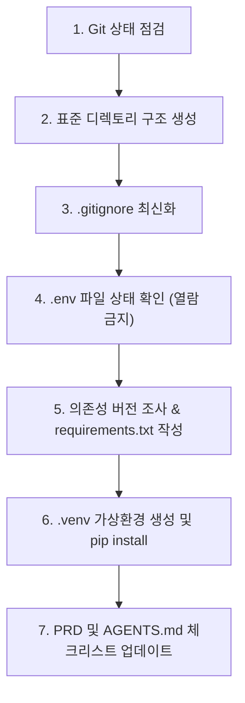

# STEP 1. 환경 준비 실행 계획서 (Environment Setup Plan)

## 1. 개요
[PRD_업무말투변환기.md](file:///C:/vibecoding/biztalk_antigravity/PRD_업무말투변환기.md)의 **STEP 1. 환경 준비**를 위한 구체적인 작업 단계 및 검증 절차입니다.

---

## 2. 세부 실행 계획

### 세부 작업 항목

1. **Git 상태 점검**
   - 레포지토리 초기화 상태 및 원격 브랜치 설정 여부 확인 (`git status`)
2. **표준 디렉토리 구조 생성**
   - `backend/routers/`, `backend/services/`, `backend/prompts/`, `backend/models/`
   - `frontend/css/`, `frontend/js/`
3. **`.gitignore` 설정**
   - `.env`, `.venv/`, `__pycache__/`, `*.pyc`, `.DS_Store`, `node_modules/` 등록
4. **`.env` 파일 확인 (보안 준수)**
   - 루트 디렉터리에 `.env`가 존재하는지만 확인 (내용 열람/출력 절대 금지)
5. **의존성 최신 버전 조사 및 `backend/requirements.txt` 작성**
   - 조사 대상: `fastapi`, `uvicorn`, `langchain`, `langchain-upstage`, `python-dotenv`, `pydantic`
   - Context7 도구 및 패키지 매니저를 통해 최신 안정 버전 확인 후 고정 명시
6. **가상환경(`.venv`) 생성 및 의존성 설치**
   - `python -m venv .venv` 실행
   - `.venv\Scripts\python.exe -m pip install -r backend/requirements.txt`
7. **문서 동기화 (규칙 8번)**
   - [PRD_업무말투변환기.md](file:///C:/vibecoding/biztalk_antigravity/PRD_업무말투변환기.md)의 `## 2. 완료 체크리스트` 및 `## 8. 단계별 구현 순서` [x] 체크
   - [AGENTS.md](file:///C:/vibecoding/biztalk_antigravity/AGENTS.md)의 `## 7. 단계별 실행 로드맵` [x] 체크

---

## 3. 검증 기준 (Verify)
- [x] 디렉토리 트리 확인 (`backend`, `frontend` 구조 완비)
- [x] `.gitignore`에 `.env` 및 `.venv/` 포함 여부 확인
- [x] `backend/requirements.txt`에 명확한 버전 표기 확인
- [x] `.venv` 내에 `fastapi`, `langchain-upstage` 등 패키지가 정상 설치되었는지 import/pip 검증 완료
- [x] PRD 및 AGENTS 마크다운 문서 상태 업데이트 확인
