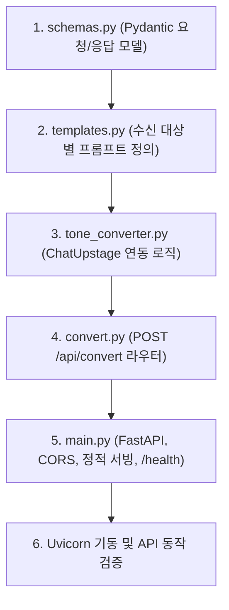

# STEP 2. 백엔드 구현 실행 계획서 (Backend Implementation Plan)

## 1. 개요
[PRD_업무말투변환기.md](file:///C:/vibecoding/biztalk_antigravity/PRD_업무말투변환기.md)의 **STEP 2. 백엔드 구현**을 위한 세부 아키텍처 설계, 구현 순서 및 검증 계획입니다.

---

## 2. 사전 조사 결과 (Investigation First)
- **Upstage 최신 모델명**: `solar-pro4` (Flagship model, 한국어 및 비즈니스 커뮤니케이션 최적화)
- **LangChain 연동 클래스**: `langchain_upstage.ChatUpstage`
- **인증 방식**: `.env` 파일의 `UPSTAGE_API_KEY` 환경 변수를 `python-dotenv`로 로드하여 자동 주입

---

## 3. 구현 모듈 및 세부 순서

### 1) `backend/models/schemas.py`
- `ConvertRequest`:
  - `text`: 필수 문자열 (최소 1자 이상)
  - `target_audience`: 필수 문자열 (`boss`, `colleague`, `client`, `team` 리터럴 검증)
- `ConvertResponse`:
  - `converted_text`: 변환된 결과 문자열
  - `target_audience`: 선택된 대상 코드
  - `original_text`: 원문 텍스트

### 2) `backend/prompts/templates.py`
- 수신 대상(4종)별 특화된 비즈니스 톤 프롬프트 템플릿:
  - `boss`: 격식 있는 공손한 경어체
  - `colleague`: 정중하고 협조적인 업무 어조
  - `client`: 친절하고 신뢰감을 주는 서비스 어조
  - `team`: 간결하고 실무적인 어조

### 3) `backend/services/tone_converter.py`
- Upstage Solar-Pro4 모델 호출 (`ChatUpstage(model_name="solar-pro4")`)
- `SystemMessage` + `HumanMessage`를 조합하여 변환 텍스트 반환
- API 호출 예외 처리 및 로깅

### 4) `backend/routers/convert.py`
- `APIRouter` 생성 (`prefix="/convert"`)
- `POST /` 엔드포인트 핸들러:
  - 요청 모델 검증
  - `convert_tone` 서비스 호출
  - 성공 시 200 OK 및 `ConvertResponse` 반환
  - 오류 발생 시 500 에러 처리

### 5) `backend/main.py`
- `FastAPI(title="업무 말투 변환기 API", version="1.0.0")` 초기화
- `dotenv.load_dotenv()` 호출
- `CORSMiddleware` 적용 (프론트엔드 통신 허용)
- `GET /health` 엔드포인트 (`{"status": "ok"}`)
- API 라우터 등록 (`prefix="/api"`)
- 프론트엔드 정적 파일 서빙 (`StaticFiles(directory="../frontend", html=True)`) 설정

---

## 4. 검증 기준 (Verify)
- [x] 백엔드 서버 정상 기동 (`uvicorn main:app` 호환 확인)
- [x] `GET /health` 호출 시 200 OK 및 `{"status": "ok"}` 확인
- [x] `GET /docs` (Swagger UI) 엔드포인트 확인
- [x] `POST /api/convert` 실제 Solar-Pro4 API 호출 및 대상별 변환 텍스트 응답 확인 (boss, colleague, client, team 4종 완료)
- [x] 잘못된 요청값에 대한 422 Unprocessable Entity 검증
- [x] PRD 및 AGENTS.md 체크리스트 업데이트 확인
