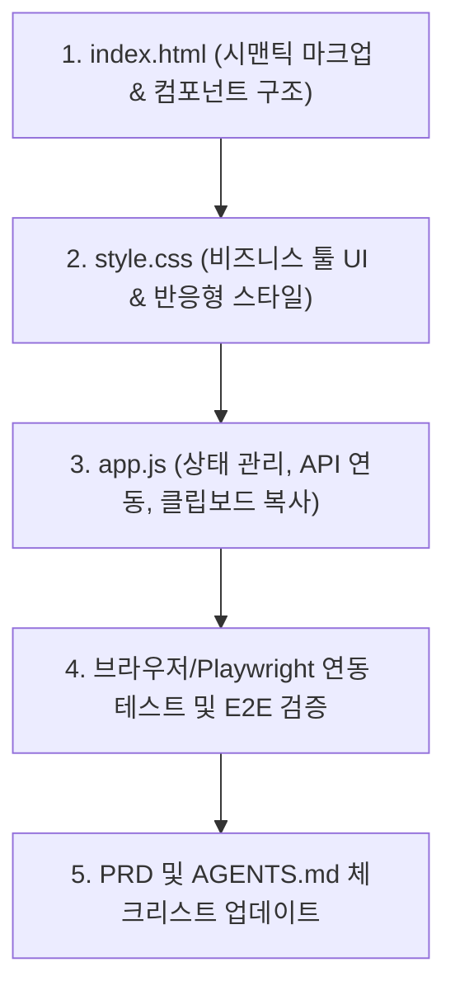

# STEP 3. 프론트엔드 구현 실행 계획서 (Frontend Implementation Plan)

## 1. 개요
[PRD_업무말투변환기.md](file:///C:/vibecoding/biztalk_antigravity/PRD_업무말투변환기.md)의 **STEP 3. 프론트엔드 구현**을 위한 UI/UX 구조 설계, 디자인 시스템, 인터랙션 구현 및 검증 계획입니다.

---

## 2. 디자인 및 사용자 경험 (UX) 전략
- **디자인 원칙 (`frontend-design` 스킬 준수)**:
  - 템플릿화된 AI 스타일(과도한 그라데이션, 유치한 장식, 둥글기 남발)을 지양하고, **전문적인 비즈니스 생산성 도구**에 걸맞은 단정하고 신뢰감 있는 레이아웃을 구축합니다.
  - 폰트: `Pretendard`, `-apple-system`, `BlinkMacSystemFont` 등 시스템 및 비즈니스 표준 고딕 계열을 사용하여 최상의 한글 가독성 확보.
  - 컬러 팔레트: 차분한 Slate/Navy 계열의 뉴트럴 톤(`slate-900`, `slate-600`, `slate-100`)에 정돈된 인디고/블루 포인트 컬러 적용.
- **인터랙션 및 접근성**:
  - 수신 대상(4종) 선택 버튼: 명확한 활성(Active) 상태 시각 피드백.
  - 직관적인 2열/상하 반응형 레이아웃: 원문 입력창과 변환 결과창의 명확한 대비.
  - 로딩 상태: 변환 중 버튼 로딩 스피너 표시 및 중복 클릭 방지(`disabled`).
  - 결과 복사: 클립보드 원클릭 복사 및 복사 완료 토스트/툴팁 알림.

---

## 3. 구현 모듈 및 세부 순서

### 1) `frontend/index.html`
- 시맨틱 HTML5 구조:
  - Header: 서비스 로고 및 브리프 설명
  - Target Selector: 4개 대상 선택 버튼 그룹 (`data-target="boss"`, `colleague`, `client`, `team`)
  - Input Section: 변환할 원문 `textarea`, 글자 수 카운터, [변환하기] 액션 버튼
  - Output Section: 변환 결과창, [복사하기] 버튼, 안내 문구
  - Toast Notification: 복사 완료 및 안내 토스트 알림창

### 2) `frontend/css/style.css`
- Modern CSS 변수 기반 디자인 토큰(Colors, Spacing, Typography, Shadows).
- 모바일-태블릿-데스크톱 반응형 그리드 및 플렉스 레이아웃.
- Active 버튼, 포커스 링, 로딩 스피너 및 토스트 애니메이션.

### 3) `frontend/js/app.js`
- 대상 선택 토글 로직 (단일 선택 유지).
- 입력값 검증 (최소 1자 이상).
- `fetch('/api/convert')` 비동기 통신 및 예외 처리.
- 로딩 인디케이터 제어 (`setLoading(true/false)`).
- `navigator.clipboard.writeText`를 활용한 결과 복사 및 토스트 피드백 표시.

---

## 4. 검증 기준 (Verify)
- [x] 브라우저에서 `http://localhost:8000/` 접속 시 정상 렌더링 확인
- [x] 수신 대상(4종) 버튼 선택 시 시각적 활성(Active) 상태 전환 확인
- [x] 텍스트 미입력 시 적절한 유효성 검사 경고 확인
- [x] 실제 텍스트 입력 후 [변환하기] 클릭 시 백엔드 API 연동 및 결과 출력 확인
- [x] 로딩 중 스피너 표시 및 버튼 비활성화 확인
- [x] [복사하기] 클릭 시 클립보드 복사 동작 및 복사 완료 피드백 확인
- [x] PRD 및 AGENTS.md 체크리스트 업데이트 확인
